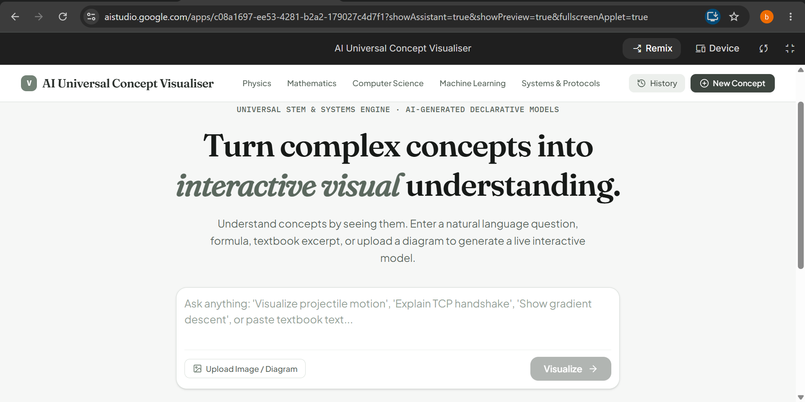
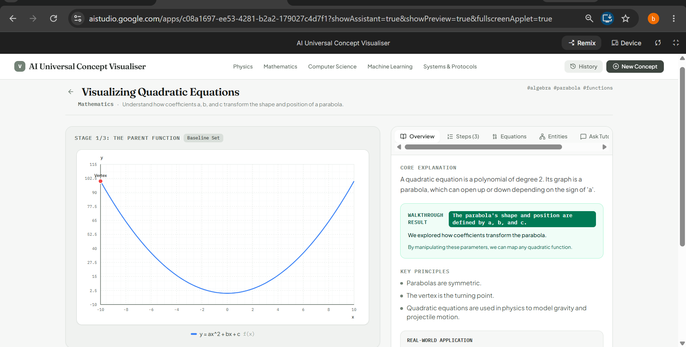
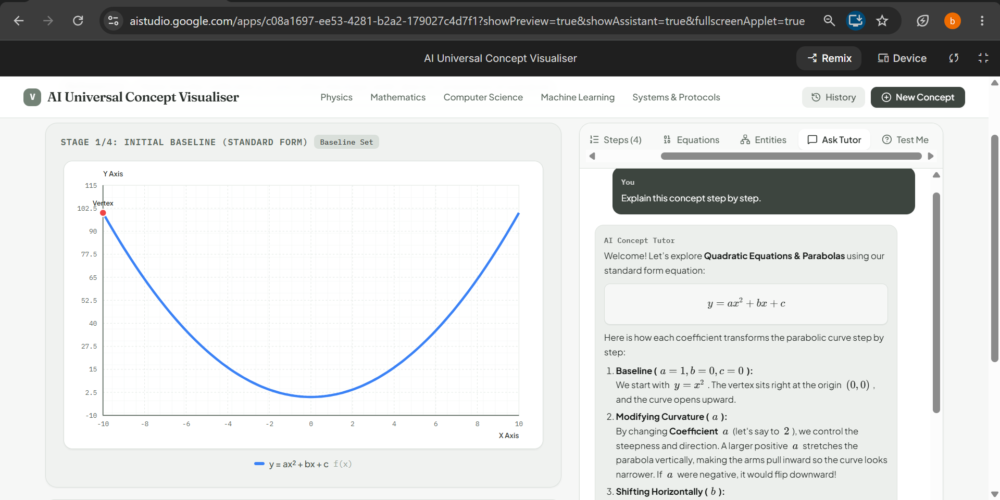
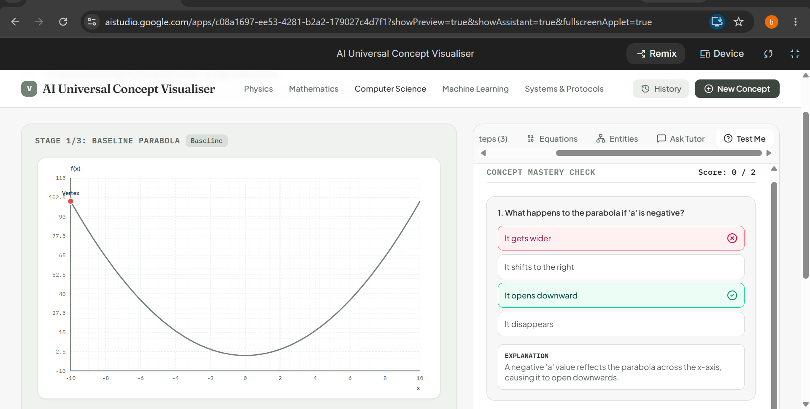
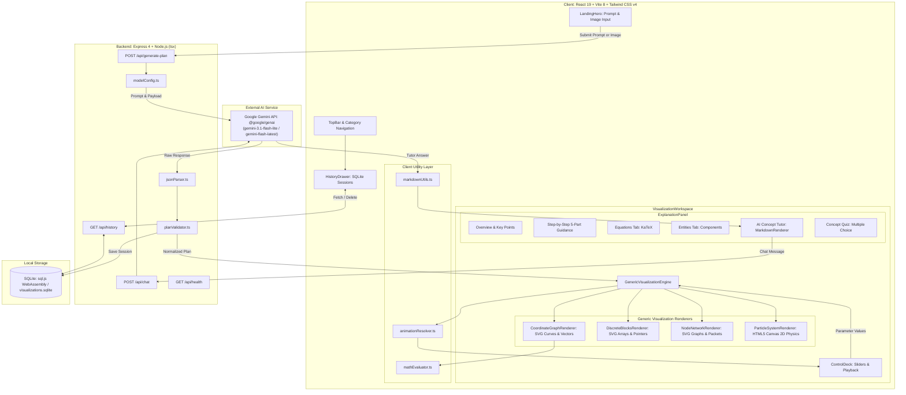
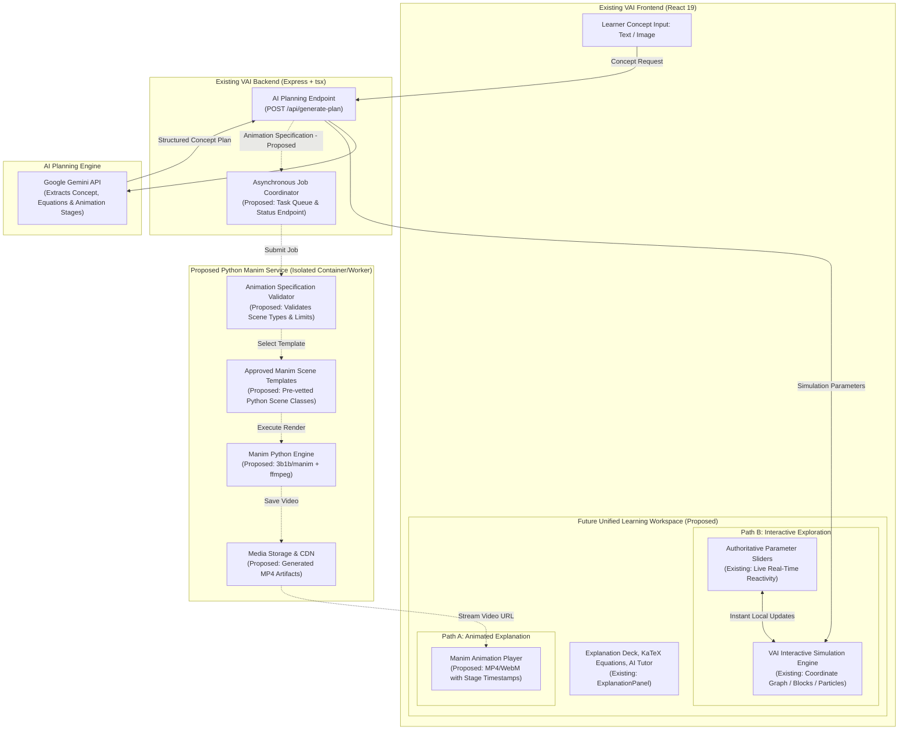

# AI Universal Concept Visualiser (VAI)

> **Interactive Multimodal Concept Learning with Declarative Visualizations & Proposed Manim Integration**

AI Universal Concept Visualiser (VAI) is an educational engineering platform designed to turn complex STEM concepts, textbook pages, equations, algorithms, and diagrams into structured, interactive visual walkthroughs.

Instead of writing one-off, hardcoded animations for every specific topic, VAI implements a **generic, declarative visualization architecture**. An AI planning engine analyzes natural language requests or uploaded diagram images and compiles them into a strictly typed visualization schema. The client then renders these plans using generic visual primitives (2D coordinate curves, discrete block pipelines, node networks, and particle systems) synchronized with live parameter sliders, step-by-step pedagogical explanations, and an AI Concept Tutor.

---

## 🌐 Live Demo

Try Visualiser here:

[Open AI Universal Concept Visualiser](https://ai-universal-concept-visualiser.ai.studio)

---

## Table of Contents

- [🌐 Live Demo](#-live-demo)
- [Overview](#overview)
- [Screenshots](#screenshots)
- [Current Implemented Features](#current-implemented-features)
- [How VAI Works Today](#how-vai-works-today)
- [Current System Architecture](#current-system-architecture)
- [Technology Stack](#technology-stack)
- [Project Structure](#project-structure)
- [Setup and Usage](#setup-and-usage)
- [Environment Variables](#environment-variables)
- [Example User Workflow](#example-user-workflow)
- [Known Limitations of Current Implementation](#known-limitations-of-current-implementation)
- [Future Development: Manim Integration](#future-development-manim-integration)
- [Proposed Post-Integration Architecture](#proposed-post-integration-architecture)
- [Proposed Integration Roadmap](#proposed-integration-roadmap)
- [Testing and Quality Assurance](#testing-and-quality-assurance)
- [Contributing](#contributing)
- [License](#license)
- [Acknowledgements](#acknowledgements)

---

## Overview

### The Problem
Mastering abstract STEM concepts—such as projectile kinematics, wave harmonics, gradient descent optimization, binary search boundaries, or CPU instruction pipelines—is notoriously difficult through static textbook text or passive diagrams. When interactive simulations do exist, they are almost universally built as single-purpose, hand-coded scripts that cannot generalize to custom parameters, novel user questions, or arbitrary curriculum material.

### The Solution
The **AI Universal Concept Visualiser (VAI)** provides a unified conceptual sandbox. Rather than hardcoding custom rendering logic for each topic:
1. Learners submit any question, formula, or diagram image.
2. The AI reasoning engine compiles the concept into a validated, declarative **Visualization Plan** JSON.
3. Four generic visual renderers dynamically execute the plan on SVG and HTML5 Canvas surfaces.
4. Parameter sliders bind directly to mathematical variables, updating curves, pointers, and forces in real time.
5. An integrated **AI Concept Tutor** provides contextual assistance with rendered Markdown and KaTeX math.

---

## Screenshots

The following screenshots capture the live user experience of the AI Universal Concept Visualiser, from multimodal concept prompting to real-time interactive simulation, AI tutoring, and knowledge verification.

### 1. Main Application Interface



*The landing interface features a clean, focused prompt bar, domain shortcuts across five STEM fields (Physics, Mathematics, Computer Science, Machine Learning, and Systems & Protocols), and support for uploading textbook excerpts, whiteboards, or formula diagrams (<5 MB).*

---

### 2. Concept Visualization & Inspection View



*A generated 2D coordinate graph visualization for **Visualizing Quadratic Equations** ($y = ax^2 + bx + c$). The left canvas renders the dynamic parabola with vertex tracking, while the right inspection panel details the core mathematical explanation, walkthrough results, key principles, and real-world applications.*

---

### 3. AI Concept Tutor



*The in-context conversational AI Concept Tutor. Learner inquiries are resolved through step-by-step pedagogical breakdowns formatted with rich Markdown and KaTeX mathematical typography (standard form, coefficient transformations, and vertex coordinates), with an independently scrollable conversation log.*

---

### 4. Concept Mastery Quiz



*The automated concept assessment engine tests conceptual mastery based on the active model. Learners receive instant color-coded feedback (correct/incorrect indicators), live score tallies, and in-depth explanations of the underlying mathematical and physical principles.*

---

## Current Implemented Features

### 1. Multimodal Concept Input
- **Natural Language Prompts:** Request visual explanations of any STEM concept (e.g., *"Show how gradient descent minimizes a loss function curve with learning rate"*).
- **Curated Starter Inspirations:** Instant access to pre-configured concept prompts across physics, mathematics, computer science, machine learning, and systems engineering.
- **Diagram and Image Analysis:** Upload textbook excerpts, whiteboard diagrams, or formulas (PNG/JPEG up to 5 MB). The backend passes image data to Gemini for multimodal extraction of underlying variables, governing equations, and stages.

### 2. Four Generic Declarative Visualization Engines
- **Coordinate Graph Renderer (`coordinate_graph`):** Plots 2D continuous functions, physics trajectories, loss landscapes, and wave harmonics. Features live mathematical formula evaluation, stable coordinate frames, dynamic peak auto-scaling, reactive markers, vector arrows, and animated curve tracers.
- **Discrete Blocks Renderer (`discrete_blocks`):** Visualizes sequential algorithms, sorting, binary search, stacks, queues, memory slots, and CPU pipeline stages (IF, ID, EX, MEM, WB). Supports block states (`active`, `comparing`, `matched`, `eliminated`, `sorted`), dynamic comparison overlays, and formula-driven pointer cursors (`low`, `mid`, `high`).
- **Node Network Renderer (`node_network`):** Renders distributed system architectures, network protocols (e.g., TCP 3-way handshake), state machines, and neural network layers. Supports multiple layouts (`horizontal`, `vertical`, `radial`, `layered`, `free`), status indicators, metrics, and animated packet transitions.
- **Particle System Renderer (`particle_system`):** HTML5 Canvas simulation for kinetic gas theory, Brownian motion, diffusion, and electrostatic or gravitational forces with velocity multipliers and collision dynamics.

### 3. Authoritative Parameter Controls & Live Reactivity
- **Interactive Control Deck:** Real-time sliders, numeric controls, and toggles bound directly to variables declared in the plan.
- **Stable Reference Scaling:** Changing parameters (e.g., initial velocity $v_0$ or launch angle $\theta$) alters physical coordinates across a stable domain, making the physical effect immediately visible.
- **Authoritative Parameter State:** User adjustments take precedence over static step overrides while preserving non-conflicting animation step phases.

### 4. Guided Step-by-Step Walkthrough
- **Timeline & Playback Controls:** Play, pause, step forward/backward, select steps directly, and toggle animation speed (0.5x, 1x, 2x).
- **Structured 5-Dimension Guidance:** Every step provides structured pedagogical breakdowns:
  1. *What is happening?* (Plain-language description of the immediate event)
  2. *Why it happens?* (Underlying physical or mathematical law)
  3. *What changed?* (Concrete variables, indices, or positions updated)
  4. *What to notice?* (Visual cues to observe on the canvas)
  5. *What happens next?* (Preview of the subsequent transition)
- **Comparison Indicators & Result Badges:** Explicit visual callouts for algorithmic decisions and terminal convergence states.

### 5. In-Depth Explanation & Inspection Deck
- **Overview Tab:** Summary, core principles, real-world applications, and common misconceptions.
- **Equations Tab:** Mathematical formulations rendered with KaTeX, variable definitions, and physical units.
- **Entities Tab:** Structural breakdown of all participating system components and roles.
- **AI Concept Tutor:** In-context chat assistant answering follow-up questions about the active model, rendered with rich Markdown (headings, lists, code spans, tables) and KaTeX math with normalized escaping.
- **Conceptual Assessment Quiz:** Automatically generated multiple-choice and conceptual questions with instant feedback and pedagogical explanations.

### 6. Persistence & Session History
- **Local SQLite Storage:** Uses WebAssembly-based `sql.js` to automatically persist generated visualization plans and session metadata to `visualizations.sqlite`. The database file is runtime-generated when missing and is excluded from version control via `.gitignore`. (Note: AI Concept Tutor conversation history is maintained in-memory on the client during the active session and is not stored in SQLite).
- **History Drawer:** Slide-out drawer allowing learners to review, reopen, or delete previous visual sessions.
- **Health Monitoring:** Built-in server health check endpoint (`/api/health`) reporting database state and API key availability.

### 7. Multi-Model Failover & Resilient Backend
- **Model Candidate Chain:** Tries `gemini-3.1-flash-lite` first; automatically fails over to `gemini-flash-latest` upon encountering transient rate limits or 503 errors.
- **Client Retry Loop:** Automatic exponential backoff with user-facing retry status reporting.
- **JSON Sanitization:** Cleans Markdown code fences and unescaped characters before JSON validation.

---

## How VAI Works Today

The existing application follows a verified, end-to-end declarative pipeline from user input to interactive simulation:

```
User Input (Text prompt or Diagram image < 5 MB)
       │
       ▼
Express Server (`POST /api/generate-plan`)
       │
       ▼
Google Gemini AI Engine (`@google/genai` with failover)
       │
       ▼
Resilient JSON Extractor (`jsonParser.ts`)
       │
       ▼
Plan Normalizer & Schema Validator (`planValidator.ts`)
       │
       ├─────────────────────────┬─────────────────────────┐
       ▼                         ▼                         ▼
SQLite Database            Client Workspace          Explanation Deck
(`visualizations.sqlite`)  (`App.tsx`)               (`ExplanationPanel.tsx`)
                                 │                         │
                                 ▼                         ├─ Step Walkthrough (5-part)
                     Animation State Resolver              ├─ KaTeX Equations Tab
                     (`animationResolver.ts`)              ├─ System Entities Tab
                                 │                         ├─ AI Concept Tutor (`/api/chat`)
                                 ▼                         └─ Conceptual Quiz
                     Generic Visualization Engine
                     (`GenericVisualizationEngine.tsx`)
                                 │
           ┌─────────────┬───────┴─────┬─────────────┐
           ▼             ▼             ▼             ▼
       Coordinate    Discrete        Node         Particle
         Graph        Blocks       Network         System
        Renderer     Renderer      Renderer       Renderer
```

1. **Input Submission:** The learner enters a text prompt or attaches an image diagram in `LandingHero.tsx`.
2. **AI Planning with Failover:** `server.ts` sends a structured prompt to Google Gemini via `@google/genai`. If the primary model encounters transient errors, it automatically falls back to secondary candidates.
3. **Resilient JSON Parsing:** `jsonParser.ts` strips code fences, repairs unescaped quotes, and extracts the JSON plan.
4. **Validation and Schema Normalization:** `planValidator.ts` validates types, injects default values, checks step sequence consistency, and sanitizes curve formulas.
5. **Persistence:** Validated visualization plans and session metadata are saved to the local `sessions` table in `visualizations.sqlite` (runtime-generated if absent, excluded from Git).
6. **Declarative State Resolution:** `animationResolver.ts` computes active step properties, interpolates numeric timeline fields, and keeps user parameter slider values authoritative.
7. **Rendering Dispatch:** `GenericVisualizationEngine.tsx` delegates rendering to the appropriate visualization component. Formulas are evaluated safely in `mathEvaluator.ts` without raw `eval`.
8. **Interactive Learning & Tutoring:** The user scrubs timeline steps, tests parameter extremes, inspects equations, tests understanding with quizzes, and chats with the AI Tutor via `POST /api/chat`.

---

## Current System Architecture



---

## Technology Stack

| Layer | Technology | Version | Purpose in Existing Codebase |
| :--- | :--- | :--- | :--- |
| **Language** | TypeScript | `^7.0.2` / `5.8+` | Strict static typing across client, server, and tests |
| **Frontend UI** | React | `^19.0.1` | Component-based interactive user interface |
| **DOM Engine** | React DOM | `^19.0.1` | Virtual DOM rendering |
| **Build Tool** | Vite | `^8.3.0` | Development bundling and production builds |
| **Vite Plugin** | `@vitejs/plugin-react` | `^6.1.1` | React JSX/TSX compilation in Vite |
| **Server Runtime**| Node.js + `tsx` | `^4.21.0` | Native TypeScript script execution for unified server |
| **HTTP Server** | Express | `^4.21.2` | REST API routes, proxying, and static distribution |
| **Styling** | Tailwind CSS v4 | `^4.3.3` | Utility-first styling with custom Smoke/Sage (`#738276`) theme |
| **AI Integration**| `@google/genai` | `^2.4.0` | Official Google GenAI SDK for Gemini API integration |
| **Math Typesetting**| KaTeX | `^0.19.0` | Fast, accessible LaTeX rendering for formulas and equations |
| **Markdown** | Marked | `^18.1.1` | Compliant Markdown lexing and tokenization for AI Tutor chat |
| **Icons** | Lucide React | `^0.546.0` | Clean, accessible SVG iconography |
| **Animation** | Motion | `^12.23.24` | UI transitions and component animations |
| **Database** | `sql.js` | `^1.14.2` | Server-side SQLite persistence in WebAssembly/Node.js; writes to runtime-generated `visualizations.sqlite` |
| **Configuration**| `dotenv` | `^17.2.3` | Local environment variable management |

---

## Project Structure

```
├── .env.example                     # Environment variables template
├── index.html                       # HTML entry point with metadata and Google Fonts
├── metadata.json                    # Application metadata and runtime permissions
├── package.json                     # Project manifest, dependencies, and scripts
├── server.ts                        # Express API server, Gemini AI caller, SQLite storage
├── tsconfig.json                    # TypeScript compiler configuration
├── visualizations.sqlite            # Runtime-generated SQLite database (excluded from Git via .gitignore)
├── vite.config.ts                   # Vite configuration (Tailwind v4, React plugin, aliases)
├── docs/
│   └── screenshots/                 # Application screenshots and interface assets
└── src/
    ├── App.tsx                      # Root orchestrator: navigation, loading, and errors
    ├── index.css                    # Tailwind CSS imports and Smoke/Sage theme definitions
    ├── main.tsx                     # React root mount and global KaTeX stylesheet import
    ├── components/
    │   ├── common/
    │   │   ├── HistoryDrawer.tsx    # Slide-out drawer displaying past sessions
    │   │   ├── LoadingState.tsx     # Animated multi-stage loading skeleton
    │   │   ├── MarkdownRenderer.tsx # Custom React Markdown + KaTeX parser & renderer
    │   │   └── TopBar.tsx           # Application navigation and category selectors
    │   ├── home/
    │   │   └── LandingHero.tsx      # Prompt input box, image uploader, and starter ideas
    │   ├── visualization/
    │   │   ├── ControlDeck.tsx      # Sliders, playback buttons, timeline step dots
    │   │   ├── CoordinateGraphRenderer.tsx # 2D continuous curves, markers, and vector fields
    │   │   ├── DiscreteBlocksRenderer.tsx  # Algorithm arrays, pointers, and memory blocks
    │   │   ├── GenericVisualizationEngine.tsx # Primary stage dispatcher and runtime state loop
    │   │   ├── NodeNetworkRenderer.tsx     # Network nodes, packet animations, and graphs
    │   │   └── ParticleSystemRenderer.tsx  # 2D Canvas physics particle simulation
    │   └── workspace/
    │       ├── ExplanationPanel.tsx        # 6-tab inspection deck, quiz, and AI Tutor chat
    │       └── VisualizationWorkspace.tsx  # Master split-pane sandbox layout
    ├── services/
    │   └── api.ts                   # Client HTTP API client, retries, and health checks
    ├── tests/
    │   └── visualization.test.ts    # Comprehensive test suite (17 regression suites)
    ├── types/
    │   └── visualization.ts         # Complete TypeScript definitions for visualization plans
    └── utils/
        ├── animationResolver.ts     # Timeline step interpolation & parameter resolution
        ├── jsonParser.ts            # Resilient JSON extractor for LLM responses
        ├── markdownUtils.ts         # Markdown escaping normalization & math placeholder extraction
        ├── mathEvaluator.ts         # Safe math formula evaluation & curve sampling
        ├── modelConfig.ts           # Gemini model selection and timeout configurations
        └── planValidator.ts         # Plan schema validation, normalization, and consistency checks
```

---

## Setup and Usage

### Prerequisites
- **Node.js:** Version `18.0.0` or higher (Node 20+ LTS recommended).
- **Package Manager:** `npm` (bundled with Node.js) or `bun`.
- **Google Gemini API Key:** Required for generating new concept plans and chatting with the AI Tutor. Obtainable from [Google AI Studio](https://aistudio.google.com/).

### Installation Steps

1. **Clone the repository:**
   ```bash
   git clone <repository-url>
   cd ai-universal-concept-visualiser
   ```

2. **Install project dependencies:**
   ```bash
   npm install
   ```

3. **Configure environment variables:**
   ```bash
   cp .env.example .env
   ```
   Open `.env` in an editor and add your Gemini API key:
   ```env
   GEMINI_API_KEY="your_actual_gemini_api_key_here"
   ```

4. **Start the development server:**
   ```bash
   npm run dev
   ```
   The development server starts at `http://localhost:3000`.

5. **Run the regression test suite:**
   ```bash
   npx tsx -e "import { runSanityTests } from './src/tests/visualization.test'; runSanityTests();"
   ```

6. **Validate TypeScript types:**
   ```bash
   npm run lint
   ```

7. **Compile for production:**
   ```bash
   npm run build
   ```

8. **Start the production server:**
   ```bash
   npm start
   ```

---

## Environment Variables

The backend configuration is managed through `.env`:

| Variable Name | Required | Default Value | Description |
| :--- | :--- | :--- | :--- |
| `GEMINI_API_KEY` | **Yes** | — | Google Gemini API key used for generating visualization plans and tutor responses. |
| `GEMINI_PRIMARY_MODEL` | No | `gemini-3.1-flash-lite` | Primary model candidate attempted for plan generation. |
| `GEMINI_FALLBACK_MODEL`| No | `gemini-flash-latest` | Fallback model used if the primary model encounters rate limits or demand spikes. |
| `PORT` | No | `3000` | Local HTTP server port. |
| `NODE_ENV` | No | `development` | Server execution environment (`development` or `production`). |
| `APP_URL` | No | — | Optional base URL for self-referential links or deployment proxies. |

---

## Example User Workflow

Here is how a learner uses VAI to explore a concrete concept today:

1. **Input:** The learner enters: *"Explain binary search visually on a sorted array of 8 elements searching for 23."*
2. **Generation:** VAI queries Gemini, validates the generated JSON plan, and stores the session in SQLite.
3. **Visualization:** The `DiscreteBlocksRenderer` renders the array `[2, 5, 8, 12, 16, 23, 38, 56]` with color-coded block states and animated pointer markers (`low`, `mid`, `high`).
4. **Step-by-Step Navigation:** The learner advances through the timeline steps:
   - *Step 1:* `low = 0`, `high = 7`, `mid = 3` (Value: 12). Comparison: `12 < 23` &rarr; narrow search to upper half.
   - *Step 2:* `low = 4`, `high = 7`, `mid = 5` (Value: 23). Comparison: `23 == 23` &rarr; target found.
5. **Guidance & Equations:** In the right-hand panel, the learner reads the 5-point guidance (*What is happening, Why it happens, What changed, What to notice, What happens next*) and inspects the time complexity equation $O(\log n)$ rendered via KaTeX.
6. **AI Tutor Follow-Up:** The learner switches to the **Ask Tutor** tab and types: *"What happens if the target is not in the array?"* The AI Tutor responds with formatted Markdown and math formulas.
7. **Knowledge Check:** The learner switches to the **Quiz** tab and answers generated conceptual questions to verify their understanding.

---

## Known Limitations of Current Implementation

To ensure complete technical transparency during review, the following boundaries of the current codebase should be noted:

- **Renderer Coverage:** Visualizations are mapped exclusively to four declarative primitives (`coordinate_graph`, `discrete_blocks`, `node_network`, `particle_system`). 3D WebGL meshes, arbitrary spatial audio, and non-Cartesian coordinate systems are not currently supported.
- **Embedded Database:** Visualization plans and session metadata are persisted using WebAssembly `sql.js` writing to a single local runtime file (`visualizations.sqlite`, excluded from Git via `.gitignore`). AI Concept Tutor conversation history is maintained in-memory per session and is not stored in SQLite. The database is designed for single-instance, lightweight local use and is not suited for multi-server distributed clustering.
- **AI Latency & Connectivity:** Plan generation and tutor chat depend on external Google Gemini API response times and active internet connectivity. Offline plan generation is not currently supported.
- **2D Continuous Domain:** The coordinate graph engine handles 2D Cartesian curves ($y = f(x)$) and vector fields. Multi-variable 3D surface plots or complex contour integrations are not supported.

---

## Future Development: Manim Integration

> **Implementation Status:** Manim integration represents proposed future work outlined in the architecture and roadmap below. It is not currently implemented in the running application, which renders all dynamic models using the four verified declarative SVG and HTML5 Canvas engines.

### What Manim Means in This Project
[Manim](https://github.com/3b1b/manim) is the open-source mathematical animation engine created by Grant Sanderson (3Blue1Brown). Built in Python, Manim is renowned for producing exceptionally clear, publication-quality mathematical animations—including coordinate system transitions, formula morphing, geometric proofs, and calculus demonstrations.

### Why Combine VAI, Manim, and Interactive Simulations?
While Manim produces world-class explanatory animations, it is a video rendering engine, not a web application framework. By itself:
- Manim does not provide a web interface where learners can type arbitrary questions.
- Manim does not allow learners to dynamically drag sliders to test parameter extremes in real time.
- Manim animations require noticeable rendering time (seconds to minutes of CPU computation per scene).

Conversely, VAI already has:
- An established text- and image-based AI concept planning pipeline.
- Real-time client-side interactive rendering engines with authoritative parameter sliders.
- A 6-tab pedagogical inspection deck with KaTeX equations and an AI Concept Tutor.

**The proposed combination creates a comprehensive learning workflow:**
- **The Explanatory Animation (Manim):** Delivers a narrative, step-by-step visual proof or derivation of the core concept.
- **The Interactive Simulation (VAI):** Sits alongside the video, allowing the learner to immediately test variables, drag sliders, and observe live mathematical reactions without waiting for new video renders.
- **The AI Planning Layer (VAI):** Automatically coordinates both views from a single structured concept plan.

---

## Proposed Post-Integration Architecture

The planned architecture cleanly separates live client interaction from asynchronous Python rendering:



### Component Breakdown of the Proposed System

1. **Existing VAI Frontend:** Remains the primary user interface. When viewing an integrated concept, it displays the rendered Manim video player alongside the interactive simulation canvas.
2. **Existing VAI Backend & AI Planning Layer:** Coordinates the pipeline. Instead of generating unrestricted raw Python code, the AI generates a strictly typed **Animation Specification** embedded within the concept plan.
3. **Proposed Validation & Animation Planning Layer:** Inspects the AI-generated animation specification against a whitelist of supported operations, preventing invalid mathematical syntax or unsupported visual objects from reaching the renderer.
4. **Proposed Python Manim Rendering Service:** A dedicated, isolated Python worker environment (running Manim and `ffmpeg`). It populates pre-vetted scene templates with validated parameters and renders MP4/WebM video clips.
5. **Interactive Simulation Layer (Reusing VAI):** Reuses VAI's existing SVG and Canvas engines (`CoordinateGraphRenderer`, `DiscreteBlocksRenderer`, etc.) to provide instant parameter experimentation. **Crucial design principle:** Changing a slider updates the client-side simulation in real time—it does *not* trigger an expensive video re-render.
6. **Unified Learning Interface:** Combines the narrative video explanation with live parameter experimentation on a single screen.
7. **Proposed Media Storage & Delivery:** Stores rendered animation clips in a local media directory (for development) or cloud object storage, returning streaming URLs to the frontend.
8. **Safety and Resource Management:** Protects system resources through strict execution isolation, job timeouts, process quotas, and sandboxing, ensuring user prompts never execute arbitrary code.

---

## Proposed Integration Roadmap

The Manim integration is planned across seven distinct, measurable phases:

### Phase 1 — Select 2–3 Target Concepts (Planned)
Focus initially on a small set of concepts where combining animated derivations with live parameter experimentation provides immediate pedagogical value:
- **Concept 1: Quadratic Equations & Parabola Vertex Form ($y = a(x-h)^2 + k$)**
  - *Manim Animation:* Animates the geometric derivation of the vertex formula and algebraic completing of the square.
  - *Interactive Simulation:* Sliders for $a$, $h$, and $k$ that immediately shift and stretch the parabola.
- **Concept 2: Projectile Motion & Kinematic Vector Decomposition**
  - *Manim Animation:* Visual proof decomposing initial launch velocity into independent $v_x$ and $v_y(t)$ vectors.
  - *Interactive Simulation:* Real-time sliders for launch velocity $v_0$ and angle $\theta$ tracing dynamic flight paths.
- **Concept 3: Binary Search Range Narrowing**
  - *Manim Animation:* Step-by-step visual demonstration of logarithmic array bisection.
  - *Interactive Simulation:* Live array size and search target controls updating pointer positions in real time.

### Phase 2 — Define a Structured Animation Specification (Planned)
- Extend `types/visualization.ts` with an optional `manim_animation` schema.
- Define declarative scene types (e.g., `equation_derivation`, `coordinate_transform`, `geometric_proof`).
- Ensure the specification uses only structured JSON definitions—never raw Python code strings.

### Phase 3 — Build a Standalone Manim Rendering Prototype (Planned)
- Set up a clean Python virtual environment with `manim` and `ffmpeg`.
- Create verified scene templates for the initial target concepts.
- Validate that the rendered animations are mathematically accurate and visually clear.

### Phase 4 — Connect Manim to the Backend (Planned)
- Implement an asynchronous task worker in `server.ts` to dispatch render jobs to the Python service.
- Implement job status polling or WebSocket progress notifications to prevent HTTP request timeouts during rendering.

### Phase 5 — Integrate Animation Display in the Frontend (Planned)
- Add a dedicated video player component to `VisualizationWorkspace.tsx`.
- Support timestamp navigation, allowing learners to jump directly to specific stages of the animation.

### Phase 6 — Harmonize Live Interactive Simulations (Planned)
- Ensure the interactive simulation canvas and the video player cross-reference the same variable names and units.
- Allow learners to scrub the video to understand the derivation, then adjust the sliders to test edge cases.

### Phase 7 — Comprehensive Testing & Evaluation (Planned)
- Benchmark rendering times, memory usage, and failure recovery.
- Gather feedback from educators and learners on concept clarity and user experience before expanding the catalog.

---

## Testing and Quality Assurance

The project includes an automated regression test suite covering all critical mathematical, animation, and rendering subsystems.

### Running Automated Tests
```bash
npx tsx -e "import { runSanityTests } from './src/tests/visualization.test'; runSanityTests();"
```

### Verified Test Coverage (17 Test Suites)
1. **Math Evaluator:** Validates exponentiation (`^`), trigonometric angle conversion (`deg2rad`), and sigmoid activation functions.
2. **JSON Parser:** Verifies extraction of JSON structures containing LaTeX backslashes (`\alpha`, `\frac`) and Markdown fences.
3. **Plan Normalization:** Verifies default parameter injection and schema validation.
4. **Animation State Resolution:** Tests continuous timeline progress (`globalProgress`) and numeric interpolation.
5. **Transient Error Classification:** Validates error handling for rate limits (429), timeouts, and service unavailability (503).
6. **Resilient JSON Extraction:** Confirms parsing resilience when LLM responses contain surrounding conversational text.
7. **Plan Consistency Validation:** Verifies cross-referencing between step entities and declared components.
8. **Model Config Resolution:** Validates timeout and candidate fallback ordering.
9. **Failover Progression:** Confirms automatic switching from primary to secondary model candidates.
10. **Transient Error Recovery:** Validates simulated retry loops and backoff schedules.
11. **Step Interpolation:** Verifies smooth numeric transitions between timeline steps.
12. **Step Count Consistency:** Enforces exact alignment between explanation cards and visual stages.
13. **Generic Parameter Reactivity:** Tests trajectory and formula reactions across Physics, Math, and CS plans.
14. **Authoritative User Parameters:** Confirms that active user slider values are not overwritten by static step definitions.
15. **Stable Coordinate Reference Frames:** Confirms that parameter adjustments yield visibly distinct SVG coordinates across fixed domains (>200px displacement verified).
16. **Live Expression Precedence:** Verifies that reactive formula expressions supersede stale static step coordinates.
17. **AI Tutor Markdown & Math Rendering:** Tests normalization of escaped Markdown characters and KaTeX equation rendering.

### Typecheck and Linter Verification
```bash
npm run lint
```
*(Runs `tsc --noEmit` and passes with 0 errors).*

### Production Build Verification
```bash
npm run build
```
*(Compiles the complete React 19 production bundle into `dist/` without warnings).*

---

## Contributing

Contributions from students, educators, and open-source developers are welcome:

1. **Fork the repository** on GitHub.
2. **Create a descriptive feature branch:**
   ```bash
   git checkout -b feature/manim-spec-design
   ```
3. **Make your changes** while adhering to the existing TypeScript and Tailwind styling conventions.
4. **Run the test suite and type checker:**
   ```bash
   npm run lint
   npx tsx -e "import { runSanityTests } from './src/tests/visualization.test'; runSanityTests();"
   npm run build
   ```
5. **Commit your changes:**
   ```bash
   git commit -m "Draft Phase 1 Manim animation schema specification"
   ```
6. **Push to your branch and open a Pull Request.**

---

## License

The license for this repository has not yet been specified. Please contact the project maintainer regarding distribution, commercial use, and contribution permissions.

---

## Acknowledgements

- **3Blue1Brown (Grant Sanderson):** For creating [Manim](https://github.com/3b1b/manim), the inspiration for the planned mathematical animation pipeline.
- **Google GenAI:** For the `@google/genai` TypeScript SDK and Gemini multimodal models.
- **KaTeX:** High-performance, browser-native mathematical typesetting.
- **Marked:** Fast, lightweight Markdown parser and compiler.
- **Lucide Icons:** Clean, accessible SVG iconography.
- **Tailwind CSS:** Modern utility-first CSS framework.
- **sql.js:** WebAssembly SQLite database engine enabling local SQL persistence.
